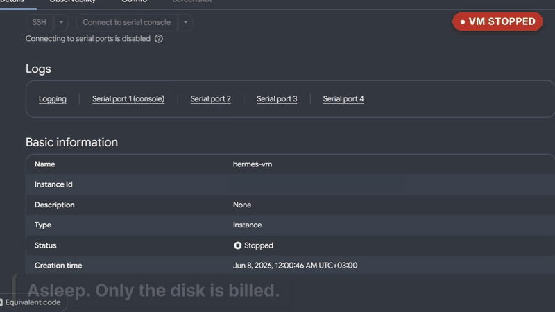
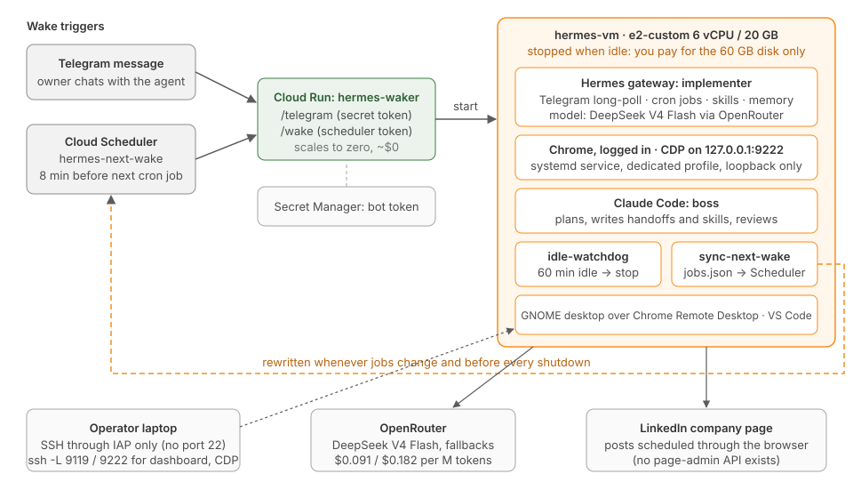

# Hermes Marketing Agent on GCP

An autonomous marketing agent that ran a 10-week LinkedIn campaign for a client. It
researches, writes, schedules posts in a real logged-in browser, and reports to its owner on
Telegram. It runs on a GCP VM that **sleeps when idle and wakes for its schedule**: no missed
posts, for about $13 a month instead of $148.

The agent is [Hermes](https://github.com/NousResearch/hermes-agent) (Nous Research). This
repository is the deployment and the operating model around it: the infrastructure scripts
from production (sanitized), the campaign skill and cron jobs, and a simulation you can run
that shows why it's built this way.



**[Watch the 10-second clip](https://github.com/ibraheemali655-spec/hermes-marketing-agent-gcp/releases/download/v1.0/hermes-wake-demo.mp4)**: a stopped VM, a Telegram message, the agent at work, then an idle hour and a shutdown, all recorded on the production setup.



## The problem

- A client had ready-made campaign assets but no one with time to keep its LinkedIn page
  active. That meant three posts a week, some needing original research.
- The agent first lived in a VM on the owner's laptop. When the laptop was off on a posting
  morning, the post **silently didn't go out**: Hermes skips a missed run after a 2-hour grace
  and never catches up. That happened on 30 May.
- Keeping a 6 vCPU / 20 GB machine on all month for three short jobs a week costs ~$148/month.
- The agent needs a full, logged-in browser (LinkedIn's company-page posting API needs app
  approval first, and page settings have no API at all), which is a
  serious credential to leave on an internet-facing machine.

## What I built

**Two agents with different jobs** ([docs/boss-implementer.md](docs/boss-implementer.md)).
Claude is the *boss*: it plans, writes handoffs with verification gates, writes the skills and
cron prompts, and reviews. Hermes on **DeepSeek V4 Flash** is the *implementer*: it runs around
the clock, follows tight scripts, and writes what it learns back into its skill. The expensive
model's work is paid once per change; the cheap model's work recurs.

**A VM that's off until it's needed** ([docs/architecture.md](docs/architecture.md)).
- A Telegram message hits a scale-to-zero Cloud Run *waker*, which starts the VM.
- **Cloud Scheduler** starts it 8 minutes before the next cron job. The schedule is computed
  from Hermes's own job store, so jobs added later from Telegram are covered automatically.
- An idle watchdog stops it after an hour idle, re-pointing the Scheduler and re-arming the
  Telegram webhook on the way down.

**A full browser, kept private** ([docs/security.md](docs/security.md)). A logged-in
Chrome on a dedicated profile, with CDP bound to `127.0.0.1` only. SSH only through IAP. No
inbound ports at all for the desktop or the dashboard. The bot token is in Secret Manager.

**A campaign that runs itself** ([docs/case-study.md](docs/case-study.md)). 30 posts over
10 weeks: pre-written campaign posts on Tuesdays, researched industry commentary on
Thursdays, educational posts on Saturdays.

## What this repository proves

`run_demo.py` replays the campaign's 30 posts on both hosts. The desktop host is a seeded
laptop on/off trace with planted absences. The GCP host is the wake-on-demand VM with the
real watchdog timings. Both use Hermes's real scheduler semantics.

```
python run_demo.py --seed 42
```

| | Posts that ran | Missed |
|---|---:|---:|
| Desktop VM on a laptop | 28 | 2 |
| GCP VM, wake-on-demand | **30** | **0** |

Across 200 seeds, the desktop misses 3.2 of 30 on average (worst case 8). GCP misses none.

| Infrastructure per month | VM hours | Total |
|---|---:|---:|
| Same VM, always on | 730 | $147.86 |
| Wake-on-demand (awake 5.3% of the time) | 38 | **$13.47** |

| Model, same token profile | $/month | |
|---|---:|---:|
| **DeepSeek V4 Flash** (implementer) | **0.50** | 1× |
| Claude Haiku 4.5 | 4.95 | 10× |
| Claude Sonnet 5.5 | 9.21 | 19× |
| Claude Opus 5.5 | 18.42 | 37× |

Prices are in [data/pricing.json](data/pricing.json); see [docs/cost.md](docs/cost.md).
The tests (`pytest`) cover the wake-time computation, the waker's auth, the scheduler's grace
semantics, and the watchdog timing.

## In production

The agent ran the client's campaign on a schedule of three posts a week, each run reported to
Telegram. The move from the laptop VM to GCP followed a real missed post (30 May). The
scripts under `infra/` are the ones that run the production VM, with identifiers replaced by
placeholders and two hardening fixes for publication: a token on the waker's `/wake`, and no
message text in its logs. The same split of a frontier model planning and a cheap model executing also
built this repository's infrastructure; one real handoff is in
[handoffs/example-native-runtime.md](handoffs/example-native-runtime.md).

## Repository layout

```
infra/          production scripts, sanitized: provision, startup, waker, scheduler, watchdog
  vm/           runs on the VM: idle-watchdog, nextwake.py, sync-next-wake, native installer
  units/        systemd units (templated for your VM user)
  waker/        Cloud Run service: /telegram, /wake, /health
hermes/         the agent's side: model routing, campaign skill, cron jobs, plan excerpt
handoffs/       the boss → implementer contract: template + a real worked example
hermes_gcp/     simulation and cost model used by run_demo.py
data/           prices and the illustrative token profile
docs/           architecture, boss/implementer, security, cost, case study, limitations
```

## Run it

```bash
pip install -e ".[dev]"
python run_demo.py
pytest
```

To deploy your own, start with `infra/config.example.sh` and the bring-up order in
[docs/architecture.md](docs/architecture.md). Read [docs/known-limitations.md](docs/known-limitations.md) first.

## About

Built by **Ibrahim Ali Ibrahim**, Google Cloud Professional Data Engineer.
[LinkedIn](https://www.linkedin.com/in/ibraheem-ali-leansixsigma) ·
[GitHub](https://github.com/ibraheemali655-spec)

Also see [ops-performance-analytics-demo](https://github.com/ibraheemali655-spec/ops-performance-analytics-demo):
an operations reporting pipeline whose monthly close is run by an LLM agent.

## License

MIT
